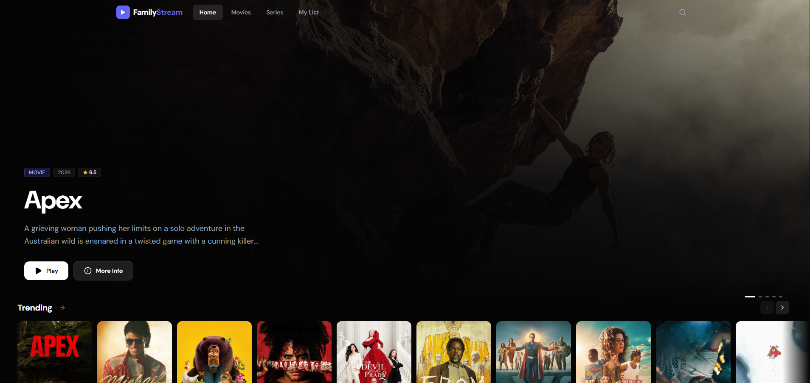
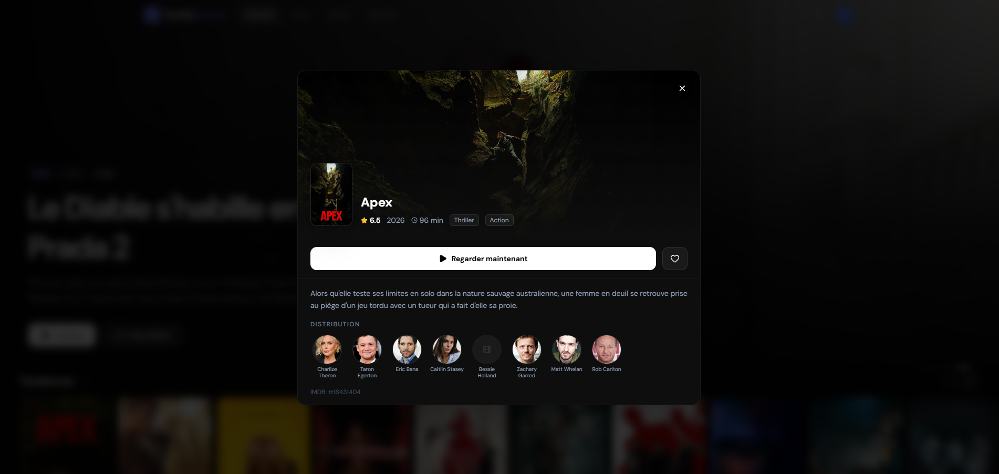

# FamilyStream — Showcase

A private streaming platform with a modern, dark-mode React interface designed for browsing, searching, and watching movies and TV series with TMDB metadata integration and an embedded media player.

---

## Interface Preview

### Home & Discovery

### Movie & Series Details

---

## Key Features

- **Dark-Mode Media Interface**: Responsive, streaming-focused UI built with TailwindCSS v4 and Lucide React.
- **Rich Catalog via TMDB**: Trending, popular, and top-rated movies and TV series with full metadata, ratings, and cast details.
- **Real-Time Multi-Search**: Instant search across movies, TV shows, and actors with an interactive dropdown and dedicated search view.
- **Integrated Playback**: In-app embedded video player with Cinema Mode and multi-server support.
- **Official Trailers**: Direct access to official YouTube trailers from each title's detail modal.
- **Favorites & Watch History**: Local persistence of favorite titles and playback progress directly in the browser.

---

## Architecture & Tech Stack

- **Frontend Framework**: React 18 with Vite
- **Styling & Icons**: TailwindCSS v4, Lucide React
- **Routing**: React Router v6
- **State Management**: Zustand with local browser persistence
- **Metadata Integration**: TMDB API
- **Deployment**: Static frontend architecture designed for lightweight edge or self-hosted delivery

---

## Source Code & Availability

This repository is a public showcase presenting the interface and technical architecture of **FamilyStream**. The application source code is maintained in a private repository.

For technical inquiries or collaboration, feel free to reach out via [GitHub](https://github.com/louislefo).
